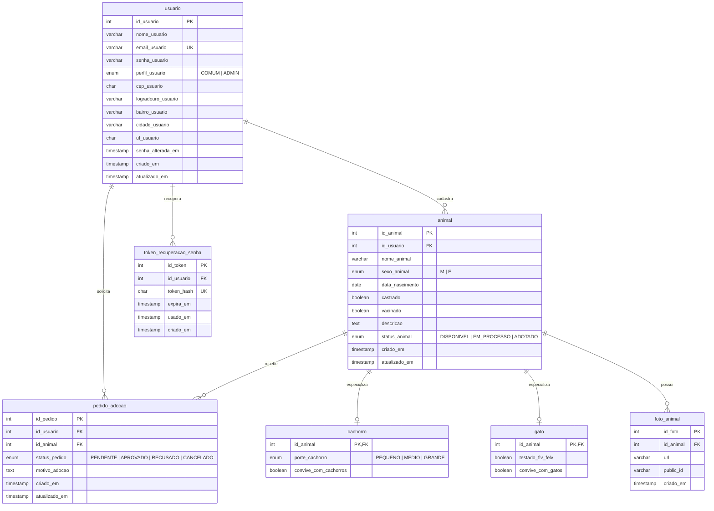

# Sistema de Adoção de Animais

API para gerenciar o processo de adoção de cães e gatos, conectando quem tem animais para doação a pessoas interessadas em adotar.

Projeto desenvolvido para o Desafio Back-end 2026/2 da Comp Júnior.

## Sumário

- [Sobre o sistema](#sobre-o-sistema)
- [Tecnologias](#tecnologias)
- [Entidades](#entidades)
- [DER](#der)
- [Regras de negócio](#regras-de-negócio)
- [Perfis e permissões](#perfis-e-permissões)
- [Autenticação e segurança](#autenticação-e-segurança)
- [Integrações externas](#integrações-externas)
- [Arquitetura](#arquitetura)
- [Configuração e execução](#configuração-e-execução)
- [Testes automatizados](#testes-automatizados)
- [Collection do Postman](#collection-do-postman)
- [Endpoints](#endpoints)

## Sobre o sistema

**Categoria:** sistema de gerenciamento do processo de adoção.

Usuários cadastram animais disponíveis para adoção, com fotos. Outros usuários fazem pedidos de adoção, que o dono do animal aprova ou recusa. O sistema acompanha o status de cada animal e de cada pedido até a adoção ser concluída, avisa as pessoas por e-mail a cada etapa e guarda o histórico.

**Inclui:** cadastro e autenticação de usuários, endereço preenchido pelo CEP, cadastro de cães e gatos com fotos, pedidos de adoção com aprovação, recusa e cancelamento, notificações por e-mail, recuperação de senha e administração de usuários.

**Não inclui:** pagamentos, chat entre usuários, agendamento de visitas.

## Tecnologias

- Node.js 22 com JavaScript
- Express 5
- PostgreSQL 17
- Prisma ORM 6
- JWT (`jsonwebtoken`) e `bcryptjs` para autenticação
- Zod para validação dos dados
- Nodemailer e Mailpit para envio de e-mails
- Cloudinary e Multer para as fotos dos animais
- Helmet e express-rate-limit para segurança
- `node:test` para testes automatizados e GitHub Actions para integração contínua
- Docker e Docker Compose

## Entidades

| Entidade | Descrição |
|---|---|
| **Usuário** | Pessoa que usa o sistema, com perfil `COMUM` ou `ADMIN` e endereço obtido pelo CEP. |
| **Animal** | Dados comuns a todo animal: nome, sexo, castração, vacinação, descrição, status e dono. |
| **Cachorro** | Dados exclusivos de cães: porte e convivência com outros cães. |
| **Gato** | Dados exclusivos de gatos: teste de FIV/FeLV e convivência com outros gatos. |
| **Pedido de Adoção** | Solicitação de um usuário para adotar um animal, com motivo e status. |
| **Foto do Animal** | Link de uma foto do animal, hospedada no Cloudinary. Cada animal pode ter até 5. |

A tabela `token_recuperacao_senha` é de apoio à recuperação de senha e não é uma entidade de negócio.

**Decisões de modelagem**

- **Especialização de animais:** os dados comuns ficam em `animal` e os exclusivos de cada espécie ficam em `cachorro` e `gato`, ligados 1:1 a `animal` pelo próprio `id_animal`. Isso evita colunas duplicadas e campos sem sentido para a outra espécie.
- **Pedido ligado diretamente a um usuário e a um animal (1:N):** cada pedido é de um único adotante para um único animal. Assim o próprio banco impede pedidos ambíguos, e as regras de aprovação ficam simples.
- **Pedidos não são excluídos, e sim cancelados**, para manter o histórico do processo de adoção.

## DER



O schema correspondente está em `prisma/schema.prisma`.

## Regras de negócio

### Usuários
- O e-mail é único (sem diferenciar maiúsculas e minúsculas). E-mail já cadastrado retorna `409`.
- A senha deve ter entre 8 e 72 caracteres, é armazenada apenas como hash (bcrypt) e nunca é retornada nas respostas.
- O cadastro público cria sempre um usuário `COMUM`. Um campo `perfil` enviado no corpo é ignorado.
- O CEP deve ter 8 dígitos, com ou sem hífen (formato inválido retorna `400`). Logradouro, bairro, cidade e UF são preenchidos pelo ViaCEP, no cadastro e na edição do perfil; CEP inexistente retorna `422`, e ViaCEP indisponível retorna `503` sem salvar dados.
- Um administrador inicial é criado automaticamente ao iniciar a API, com os dados de `ADMIN_EMAIL` e `ADMIN_PASSWORD`, se ainda não existir.
- O usuário pode alterar o próprio nome e CEP. **O e-mail não pode ser alterado**, porque é o login da conta e o canal da recuperação de senha; campos como `email` e `perfil` enviados na edição são ignorados.
- Para trocar a senha, é preciso informar a senha atual. Depois da troca, os tokens emitidos antes deixam de valer.
- Para excluir a própria conta, é preciso confirmar a senha. A exclusão remove os animais do usuário e os pedidos que ele fez; animais de outras pessoas que ficarem sem pedidos pendentes voltam para `DISPONIVEL`.
- Contas com adoção concluída (como dono ou como adotante) não podem ser excluídas (`409`), para preservar o histórico.
- O administrador pode promover um usuário a `ADMIN` ou voltá-lo a `COMUM`, mas não pode alterar o próprio perfil.
- Administradores não podem ser excluídos nem excluir a própria conta (`403`), para que o sistema nunca fique sem administrador.

### Animais
- Todo animal é cadastrado como cachorro ou como gato (`especie`), com os dados específicos da espécie em `cachorro` ou `gato`. O animal e seus dados específicos são criados na mesma transação.
- A espécie não pode ser alterada depois do cadastro. Na edição, só são aceitos os dados específicos da espécie do animal (`400` caso contrário).
- O animal é cadastrado com status `DISPONIVEL`. O status não é editado diretamente: ele muda conforme os pedidos de adoção.
- A data de nascimento é opcional, no formato `AAAA-MM-DD`, e não pode estar no futuro.
- Qualquer pessoa, mesmo sem login, pode listar e ver os animais, com filtros por espécie, status, sexo, porte, cidade e UF do dono.
- Só o dono do animal ou um administrador pode editá-lo ou excluí-lo (`403` caso contrário).
- Animal com status `ADOTADO` não pode ser editado nem excluído (`409`), para preservar o histórico.
- Ao excluir um animal ainda não adotado, os pedidos dele são excluídos junto.

### Fotos dos animais
- Só o dono do animal ou um administrador envia e remove fotos. Animal `ADOTADO` não recebe nem perde fotos (`409`).
- Cada animal pode ter até 5 fotos (`409` acima disso), em JPG, PNG ou WEBP (`400` para outros tipos), com até 5 MB cada (`413`).
- As imagens ficam no Cloudinary; o banco guarda só o link e o identificador de cada uma.
- Ao remover uma foto ou excluir o animal, os arquivos também são apagados do Cloudinary.
- Se o Cloudinary não estiver configurado, o envio de fotos responde `503` e o restante do sistema funciona normalmente.

### Pedidos de adoção
- O usuário não pode pedir para adotar o próprio animal (`403`).
- Não é possível pedir um animal com status `ADOTADO` (`409`).
- Cada usuário pode ter apenas um pedido pendente por animal (`409`).
- O motivo é obrigatório, com 10 a 1000 caracteres.
- O primeiro pedido muda o animal para `EM_PROCESSO`.
- Só o adotante pode alterar o motivo do próprio pedido, e só enquanto ele estiver `PENDENTE`.
- Só o dono do animal (ou um administrador) aprova ou recusa. Ao aprovar, o pedido vira `APROVADO`, o animal vira `ADOTADO` e os demais pedidos pendentes do animal são recusados automaticamente, tudo numa única transação.
- O adotante (ou um administrador) pode cancelar o pedido enquanto ele estiver `PENDENTE`.
- Quando um pedido é recusado ou cancelado e o animal não tem mais pedidos pendentes, o animal volta para `DISPONIVEL`.
- `APROVADO`, `RECUSADO` e `CANCELADO` são status finais (`409` ao tentar mudá-los).
- Um pedido só pode ser visto pelo adotante, pelo dono do animal ou por um administrador.
- **Não existe exclusão de pedidos:** eles são cancelados ou recusados, para manter o histórico do processo de adoção.

### Notificações por e-mail
- Quando um pedido é criado, o dono do animal recebe um e-mail com o nome do interessado e o motivo.
- Quando o pedido é aprovado ou recusado, quem pediu recebe um e-mail com a decisão.
- Uma falha no envio do e-mail não desfaz o pedido nem a decisão: o erro fica registrado apenas no log do servidor.

## Perfis e permissões

| Recurso | Ação | Visitante (sem login) | Usuário Comum | Administrador |
|---|---|---|---|---|
| Usuário | Ver e editar o próprio perfil | ❌ | ✅ | ✅ |
| Usuário | Trocar a própria senha | ❌ | ✅ | ✅ |
| Usuário | Excluir a própria conta | ❌ | ✅ | ❌ |
| Usuário | Listar e ver usuários | ❌ | ❌ | ✅ |
| Usuário | Alterar o perfil de outro usuário | ❌ | ❌ | ✅ |
| Usuário | Excluir outro usuário | ❌ | ❌ | ✅ (exceto administradores) |
| Animal | Listar e visualizar | ✅ | ✅ | ✅ |
| Animal | Cadastrar | ❌ | ✅ | ✅ |
| Animal | Editar e excluir | ❌ | Somente os próprios | ✅ |
| Foto | Enviar e remover | ❌ | Somente dos próprios animais | ✅ |
| Pedido | Criar | ❌ | ✅ (exceto para animal próprio) | ✅ |
| Pedido | Listar os próprios pedidos | ❌ | ✅ | ✅ |
| Pedido | Listar os pedidos de um animal | ❌ | Somente dos próprios animais | ✅ |
| Pedido | Listar todos os pedidos | ❌ | ❌ | ✅ |
| Pedido | Ver um pedido | ❌ | Se for o adotante ou o dono do animal | ✅ |
| Pedido | Alterar o motivo | ❌ | Somente os próprios, se pendentes | ❌ |
| Pedido | Aprovar e recusar | ❌ | Somente pedidos dos próprios animais | ✅ |
| Pedido | Cancelar | ❌ | Somente os próprios, se pendentes | ✅ |

## Autenticação e segurança

- **Login com JWT:** `POST /auth/login` devolve um token que deve ser enviado nas rotas protegidas no cabeçalho `Authorization: Bearer <token>`. O token expira conforme `JWT_EXPIRES_IN` (padrão: 1 hora).
- **Sem token, ou com token inválido ou expirado:** `401`. **Perfil sem permissão:** `403`. O perfil é conferido no banco a cada requisição, então uma mudança de perfil vale imediatamente.
- **Mensagem única no login:** e-mail inexistente e senha errada retornam a mesma mensagem, para não revelar quais e-mails estão cadastrados.
- **Recuperação de senha:**
  - `POST /auth/forgot-password` sempre responde a mesma mensagem, exista o e-mail ou não.
  - O código enviado por e-mail é aleatório (256 bits), vale por `RESET_TOKEN_EXPIRES_MINUTES` minutos (padrão: 15) e pode ser usado uma única vez.
  - No banco fica guardado apenas o hash SHA-256 do código, nunca o código em si.
  - Pedir um novo código invalida os anteriores.
  - Ao redefinir ou trocar a senha, todos os tokens JWT emitidos antes da troca deixam de valer.
- **Limite de tentativas (`429`):** login (20 a cada 15 minutos), cadastro (20 por hora) e recuperação de senha (5 a cada 15 minutos), por endereço IP.
- **Cabeçalhos de segurança:** aplicados com Helmet; o cabeçalho `X-Powered-By` é removido.
- **Limite de tamanho:** o corpo JSON das requisições é limitado a 100 kB (`413`); as fotos, a 5 MB.
- **Erros:** respostas de erro nunca expõem detalhes internos. Erros conhecidos do banco são traduzidos (registro inexistente `404`, conflito `409`, banco indisponível `503`), e erros inesperados retornam `500` com mensagem genérica.
- **Credenciais:** ficam apenas no `.env`, que não é versionado. Em produção, a API se recusa a iniciar com o `JWT_SECRET` de exemplo.
- **Dependências:** auditadas com `npm audit`. Os alertas restantes estão em ferramentas de desenvolvimento (CLI do Prisma e nodemon) ou não se aplicam ao projeto (o alerta do Zod trata de listas muito grandes, e nenhum schema valida listas).

## Integrações externas

| Serviço | Uso no sistema | Configuração |
|---|---|---|
| **ViaCEP** (https://viacep.com.br) | No cadastro e na edição do perfil, preenche logradouro, bairro, cidade e UF a partir do CEP. Isso padroniza o endereço e permite filtrar animais por cidade e estado do dono. | Nenhuma: gratuito e sem chave |
| **Cloudinary** (https://cloudinary.com) | Armazena as fotos dos animais e entrega cada uma por um link público. A foto é o que mais pesa na decisão de quem adota; as imagens ficam fora do banco e do container, e o banco guarda só os links. | Opcional: conta gratuita e 3 variáveis no `.env` (veja [Fotos dos animais](#fotos-dos-animais-opcional)) |

## Arquitetura

O projeto segue princípios de Clean Architecture. As regras de negócio (casos de uso) não importam Express, Prisma, bcrypt, JWT, Nodemailer nem Cloudinary: recebem pelo construtor objetos com os métodos de que precisam. O único lugar que conhece as implementações concretas é o `src/container.js`. Por isso as regras podem ser testadas sem banco, sem e-mail e sem serviços externos.

```
src/
├── config/
│   └── env.js            # Leitura das variáveis de ambiente
├── domain/
│   ├── constants.js      # Perfis, espécies e status do negócio
│   ├── errors/           # Erros de aplicação (AppError)
│   └── policies/         # Regras de permissão (dono, adotante, admin)
├── application/
│   ├── use-cases/        # Regras de negócio
│   │   ├── auth/         # Cadastro, login e recuperação de senha
│   │   ├── usuarios/     # Perfil, senha, exclusão de conta e administração
│   │   ├── animais/      # CRUD de animais e fotos
│   │   └── pedidos/      # Pedidos de adoção e notificações
│   └── utils/
├── infra/                # Implementações técnicas
│   ├── database/         # Prisma, repositórios e tradução de erros do banco
│   ├── security/         # bcrypt, JWT e geração de código de recuperação
│   ├── mail/             # Envio de e-mail (Nodemailer)
│   ├── cep/              # Integração com o ViaCEP
│   └── storage/          # Integração com o Cloudinary
├── interfaces/
│   └── http/             # Rotas, controllers, validações e middlewares do Express
├── container.js          # Monta as dependências e liga as camadas
├── app.js                # Montagem da aplicação Express
└── server.js             # Inicialização do servidor

tests/unit/               # Testes automatizados das regras de negócio
prisma/                   # Schema, migrations e dados de exemplo (seed)
.github/workflows/        # Integração contínua (GitHub Actions)
docs/collection.json      # Collection do Postman
```

Todos os erros passam por um middleware global (`interfaces/http/middlewares/errorHandler.js`), que devolve respostas no formato `{ "error": { "message": "..." } }` e nunca expõe detalhes internos.

## Configuração e execução

### Pré-requisitos
- [Docker Desktop](https://www.docker.com/products/docker-desktop/) (ou Docker Engine com Docker Compose)
- Git

### Passos

1. Clone o repositório:
   ```bash
   git clone https://github.com/IsadoraRB-dge/Trilha-Backend-CompJr.git
   cd Trilha-Backend-CompJr
   ```
2. Crie o arquivo `.env` a partir do exemplo. Os valores padrão já funcionam para rodar localmente:
   ```bash
   cp .env.example .env
   ```
   No Windows (PowerShell): `Copy-Item .env.example .env`
3. *(Opcional)* Para ativar o envio de fotos, preencha as variáveis do Cloudinary no `.env`, conforme [Fotos dos animais](#fotos-dos-animais-opcional). Sem elas, todo o resto funciona.
4. Suba o ambiente:
   ```bash
   docker-compose up --build
   ```
   Sobem três serviços: o banco (PostgreSQL), o Mailpit (servidor de e-mail de testes) e a API. As migrations são aplicadas e o administrador inicial é criado automaticamente.
5. Verifique se está tudo funcionando:
   ```bash
   curl http://localhost:3000/health
   ```
   Resposta esperada: `{"status":"ok","database":"ok"}`
6. *(Recomendado)* Em outro terminal, crie os dados de exemplo:
   ```bash
   docker compose exec api npm run seed
   ```

### Serviços disponíveis

| Serviço | Endereço |
|---|---|
| API | `http://localhost:3000` |
| Caixa de e-mails (Mailpit) | `http://localhost:8025` |

### Usuários para teste

| Perfil | E-mail | Senha | Situação |
|---|---|---|---|
| Administrador | `admin@adocao.local` | `Admin@12345` | Criado automaticamente ao iniciar a API |
| Comum | `ana@exemplo.com` | `senha12345` | Dona do cachorro Rakan e da gata Zoe; tem um pedido pendente para responder |
| Comum | `bruno@exemplo.com` | `senha12345` | Dono do cachorro Thor e da gata Luna |
| Comum | `carla@exemplo.com` | `senha12345` | Pediu o Rakan e já adotou a Luna |

Os usuários comuns são criados pelo comando `npm run seed` (passo 6). O seed pode ser executado mais de uma vez sem duplicar dados. Todos esses valores servem apenas para o ambiente local.

### Testar a recuperação de senha e as notificações

1. Envie `POST /auth/forgot-password` com o e-mail de um usuário cadastrado.
2. Abra `http://localhost:8025`. O e-mail "Recuperação de senha" aparece na caixa de entrada com o código.
3. Envie `POST /auth/reset-password` com o código e a nova senha.

As notificações de pedidos aparecem na mesma caixa: entre como `ana@exemplo.com` e aprove o pedido pendente do Rakan, e o e-mail de aprovação para `carla@exemplo.com` aparece no Mailpit. Nenhum e-mail real é enviado: o Mailpit captura todas as mensagens localmente.

### Fotos dos animais (opcional)

O envio de fotos usa o Cloudinary, que exige uma conta gratuita:

1. Crie a conta em https://cloudinary.com.
2. No painel, abra **API Keys** e copie o **Cloud name**, a **API Key** e o **API Secret**.
3. Preencha no `.env`:
   ```
   CLOUDINARY_CLOUD_NAME=seu_cloud_name
   CLOUDINARY_API_KEY=sua_api_key
   CLOUDINARY_API_SECRET=seu_api_secret
   ```
4. Reinicie o ambiente: `docker-compose down` e `docker-compose up --build`.

Para enviar uma foto, use a requisição **Enviar foto** da collection (selecionando um arquivo no campo `foto`) ou:
```bash
curl -X POST http://localhost:3000/animais/1/fotos -H "Authorization: Bearer <token>" -F "foto=@caminho/da/imagem.jpg"
```

### Variáveis de ambiente

| Variável | Descrição | Padrão |
|---|---|---|
| `POSTGRES_USER` | Usuário do PostgreSQL | `admin` |
| `POSTGRES_PASSWORD` | Senha do PostgreSQL | `adocao_dev` |
| `POSTGRES_DB` | Nome do banco | `adocao` |
| `POSTGRES_PORT` | Porta do PostgreSQL no seu computador | `5433` |
| `API_PORT` | Porta da API no seu computador | `3000` |
| `DATABASE_URL` | URL do banco usada pelo Prisma fora do Docker | ver `.env.example` |
| `JWT_SECRET` | Chave de assinatura dos tokens JWT | valor de desenvolvimento |
| `JWT_EXPIRES_IN` | Validade do token JWT | `1h` |
| `RESET_TOKEN_EXPIRES_MINUTES` | Validade do código de recuperação, em minutos | `15` |
| `SMTP_HOST` / `SMTP_PORT` | Servidor de e-mail usado fora do Docker | `localhost` / `1025` |
| `MAIL_FROM` | Remetente dos e-mails | `Adoção de Animais <nao-responda@adocao.local>` |
| `MAILPIT_UI_PORT` | Porta da caixa de e-mails no seu computador | `8025` |
| `MAILPIT_SMTP_PORT` | Porta SMTP do Mailpit no seu computador | `1025` |
| `ADMIN_NAME` / `ADMIN_EMAIL` / `ADMIN_PASSWORD` | Dados do administrador inicial | ver `.env.example` |
| `CLOUDINARY_CLOUD_NAME` / `CLOUDINARY_API_KEY` / `CLOUDINARY_API_SECRET` | Credenciais do Cloudinary (opcionais) | vazio (fotos desativadas) |

Se alguma das portas já estiver em uso no seu computador, altere a variável correspondente no `.env`.

### Desenvolvimento sem Docker para a API (opcional)

Com o banco e o Mailpit rodando pelo Docker (`docker-compose up -d db mailpit`):
```bash
npm install
npx prisma migrate dev
npm run seed
npm run dev
```

## Testes automatizados

As regras de negócio têm 23 testes automatizados, escritos com o `node:test` (nativo do Node.js). Eles usam versões falsas do banco, do e-mail, do ViaCEP e do Cloudinary, então rodam em segundos e não precisam de Docker:

```bash
npm install
npm test
```

Os testes cobrem, entre outros: cadastro e login, recuperação de senha com código expirado ou reutilizado, permissões de dono, adotante e administrador, regras dos pedidos, proteção de animais adotados, exclusão de conta, notificações por e-mail e fotos.

O GitHub Actions (`.github/workflows/testes.yml`) roda os testes automaticamente a cada push nas branches `main` e `develop` e a cada Pull Request.

## Collection do Postman

A collection com todas as rotas está em **`docs/collection.json`**.

**Como importar:** no Postman, clique em **Import**, selecione o arquivo `docs/collection.json` e confirme.

**Configuração:** nenhuma é obrigatória. A collection já vem com a variável `baseUrl` = `http://localhost:3000`. Os tokens e IDs são preenchidos automaticamente pelas próprias requisições:
- as requisições de **login** salvam o token em `tokenAdmin`, `tokenAna` ou `tokenCarla`;
- **Cadastrar cachorro**, **Criar pedido** e **Enviar foto** salvam o ID criado em `animalId`, `pedidoId` e `fotoId`.

**Ordem sugerida**, depois de rodar o seed:
1. Pasta **1. Autenticação**: faça os três logins (admin, Ana e Carla).
2. Pasta **3. Animais**: liste, cadastre um cachorro com a Ana e teste edição e filtros.
3. Pasta **5. Pedidos**: crie um pedido com a Carla e aprove com a Ana. Confira o e-mail no Mailpit.
4. Pastas **2. Usuários**, **4. Fotos** e **6. Administração** em qualquer ordem.

Para a recuperação de senha, copie o código do e-mail no Mailpit para a variável `codigoRecuperacao` (aba **Variables** da collection) antes de enviar **Redefinir senha**.

## Endpoints

Formato de erro em todas as rotas:
```json
{ "error": { "message": "Descrição do erro" } }
```
Erros de validação (`400`) trazem também `details`, com o campo e a mensagem de cada problema. Em qualquer rota, um corpo maior que o permitido retorna `413`, e um erro inesperado retorna `500` com mensagem genérica.

### Resumo

| Método | Caminho | Descrição | Acesso |
|---|---|---|---|
| GET | `/health` | Verifica se a API e o banco estão no ar | Público |
| POST | `/auth/register` | Cadastra um usuário comum | Público |
| POST | `/auth/login` | Autentica e devolve o token JWT | Público |
| GET | `/auth/me` | Dados do usuário autenticado | Autenticado |
| POST | `/auth/forgot-password` | Envia o código de recuperação por e-mail | Público |
| POST | `/auth/reset-password` | Redefine a senha com o código recebido | Público |
| PATCH | `/usuarios/me` | Altera nome e CEP do próprio perfil | Autenticado |
| PATCH | `/usuarios/me/senha` | Troca a própria senha | Autenticado |
| DELETE | `/usuarios/me` | Exclui a própria conta | Autenticado (exceto administradores) |
| GET | `/usuarios` | Lista todos os usuários | Administrador |
| GET | `/usuarios/:id` | Detalhes de um usuário | Administrador |
| PATCH | `/usuarios/:id/perfil` | Altera o perfil de um usuário | Administrador |
| DELETE | `/usuarios/:id` | Exclui um usuário | Administrador |
| GET | `/animais` | Lista animais, com filtros e paginação | Público |
| GET | `/animais/:id` | Detalhes de um animal, com fotos | Público |
| POST | `/animais` | Cadastra um animal | Autenticado |
| PATCH | `/animais/:id` | Altera um animal | Dono ou administrador |
| DELETE | `/animais/:id` | Exclui um animal | Dono ou administrador |
| POST | `/animais/:id/fotos` | Envia uma foto do animal | Dono ou administrador |
| DELETE | `/animais/:id/fotos/:fotoId` | Remove uma foto do animal | Dono ou administrador |
| POST | `/animais/:id/pedidos` | Faz um pedido de adoção | Autenticado (exceto o dono) |
| GET | `/animais/:id/pedidos` | Lista os pedidos recebidos por um animal | Dono ou administrador |
| GET | `/pedidos/meus` | Lista os pedidos feitos pelo usuário | Autenticado |
| GET | `/pedidos` | Lista todos os pedidos | Administrador |
| GET | `/pedidos/:id` | Detalhes de um pedido | Adotante, dono do animal ou administrador |
| PATCH | `/pedidos/:id` | Altera o motivo do pedido | Adotante |
| PATCH | `/pedidos/:id/aprovar` | Aprova o pedido | Dono ou administrador |
| PATCH | `/pedidos/:id/recusar` | Recusa o pedido | Dono ou administrador |
| PATCH | `/pedidos/:id/cancelar` | Cancela o pedido | Adotante ou administrador |

Rotas marcadas como autenticadas exigem o cabeçalho `Authorization: Bearer <token>`.

**Paginação:** as listagens de animais e pedidos aceitam `pagina` (padrão `1`) e `limite` (padrão `10`, máximo `50`) na query string e respondem no formato:
```json
{
  "dados": [],
  "paginacao": { "pagina": 1, "limite": 10, "total": 0, "totalPaginas": 0 }
}
```

### GET `/health`

**Resposta `200`:**
```json
{ "status": "ok", "database": "ok" }
```
**`503`:** banco indisponível.

### POST `/auth/register`

| Campo | Tipo | Obrigatório | Regras |
|---|---|---|---|
| `nome` | texto | Sim | 2 a 100 caracteres |
| `email` | texto | Sim | E-mail válido, até 150 caracteres |
| `senha` | texto | Sim | 8 a 72 caracteres |
| `cep` | texto | Sim | 8 dígitos, com ou sem hífen |

**Requisição:**
```json
{
  "nome": "Maria Silva",
  "email": "maria@email.com",
  "senha": "senhaSegura123",
  "cep": "01001-000"
}
```
**Resposta `201`:**
```json
{
  "id": 2,
  "nome": "Maria Silva",
  "email": "maria@email.com",
  "perfil": "COMUM",
  "cep": "01001000",
  "logradouro": "Praça da Sé",
  "bairro": "Sé",
  "cidade": "São Paulo",
  "uf": "SP",
  "criadoEm": "2026-10-18T12:00:00.000Z",
  "atualizadoEm": "2026-10-18T12:00:00.000Z"
}
```
**Erros:** `400` dados inválidos · `409` e-mail já cadastrado · `422` CEP não encontrado · `429` muitas tentativas · `503` ViaCEP indisponível.

### POST `/auth/login`

| Campo | Tipo | Obrigatório |
|---|---|---|
| `email` | texto | Sim |
| `senha` | texto | Sim |

**Requisição:**
```json
{ "email": "maria@email.com", "senha": "senhaSegura123" }
```
**Resposta `200`:**
```json
{
  "token": "eyJhbGciOiJIUzI1NiIsInR5cCI6IkpXVCJ9...",
  "usuario": { "id": 2, "nome": "Maria Silva", "email": "maria@email.com", "perfil": "COMUM" }
}
```
O objeto `usuario` traz os mesmos campos da resposta do cadastro.

**Erros:** `400` dados inválidos · `401` e-mail ou senha inválidos · `429` muitas tentativas.

### GET `/auth/me`

**Cabeçalho:** `Authorization: Bearer <token>`

**Resposta `200`:** os dados do usuário autenticado, no mesmo formato da resposta do cadastro.

**Erros:** `401` token ausente, inválido, expirado ou emitido antes de uma troca de senha.

### POST `/auth/forgot-password`

| Campo | Tipo | Obrigatório |
|---|---|---|
| `email` | texto | Sim |

**Requisição:**
```json
{ "email": "maria@email.com" }
```
**Resposta `200` (sempre a mesma, exista o e-mail ou não):**
```json
{ "message": "Se o e-mail estiver cadastrado, você receberá as instruções para redefinir a senha." }
```
**Erros:** `400` dados inválidos · `429` muitas tentativas.

### POST `/auth/reset-password`

| Campo | Tipo | Obrigatório | Regras |
|---|---|---|---|
| `token` | texto | Sim | Código recebido por e-mail |
| `novaSenha` | texto | Sim | 8 a 72 caracteres |

**Requisição:**
```json
{ "token": "código-recebido-por-email", "novaSenha": "novaSenha456" }
```
**Resposta `200`:**
```json
{ "message": "Senha redefinida com sucesso. Faça login com a nova senha." }
```
**Erros:** `400` dados inválidos, ou código inválido, expirado ou já utilizado · `429` muitas tentativas.

### PATCH `/usuarios/me`

**Cabeçalho:** `Authorization: Bearer <token>`

Envie pelo menos um dos campos. O e-mail não pode ser alterado.

| Campo | Tipo | Obrigatório | Regras |
|---|---|---|---|
| `nome` | texto | Não | 2 a 100 caracteres |
| `cep` | texto | Não | 8 dígitos, com ou sem hífen. O endereço é atualizado pelo ViaCEP |

**Requisição:**
```json
{ "nome": "Maria Souza", "cep": "01310-100" }
```
**Resposta `200`:** o usuário atualizado, no mesmo formato da resposta do cadastro.

**Erros:** `400` dados inválidos · `401` não autenticado · `422` CEP não encontrado · `503` ViaCEP indisponível.

### PATCH `/usuarios/me/senha`

**Cabeçalho:** `Authorization: Bearer <token>`

| Campo | Tipo | Obrigatório | Regras |
|---|---|---|---|
| `senhaAtual` | texto | Sim | Senha atual do usuário |
| `novaSenha` | texto | Sim | 8 a 72 caracteres, diferente da atual |

**Requisição:**
```json
{ "senhaAtual": "senhaSegura123", "novaSenha": "novaSenha456" }
```
**Resposta `200`:**
```json
{ "message": "Senha alterada com sucesso. Faça login novamente com a nova senha." }
```
Os tokens emitidos antes da troca deixam de valer.

**Erros:** `400` dados inválidos, senha atual incorreta ou nova senha igual à atual · `401` não autenticado.

### DELETE `/usuarios/me`

**Cabeçalho:** `Authorization: Bearer <token>`

| Campo | Tipo | Obrigatório | Regras |
|---|---|---|---|
| `senha` | texto | Sim | Senha atual, para confirmar a exclusão |

**Requisição:**
```json
{ "senha": "senhaSegura123" }
```
**Resposta `204`:** sem conteúdo. Os animais do usuário e os pedidos que ele fez são excluídos.

**Erros:** `400` dados inválidos ou senha incorreta · `401` não autenticado · `403` administrador · `409` conta com adoção concluída.

### GET `/usuarios`

**Cabeçalho:** `Authorization: Bearer <token de administrador>`

**Resposta `200`:** lista de usuários, cada um no mesmo formato da resposta do cadastro.

**Erros:** `401` não autenticado · `403` usuário sem perfil de administrador.

### GET `/usuarios/:id`

**Cabeçalho:** `Authorization: Bearer <token de administrador>`

**Resposta `200`:** o usuário, no mesmo formato da resposta do cadastro.

**Erros:** `400` ID inválido · `401` não autenticado · `403` não é administrador · `404` usuário não encontrado.

### PATCH `/usuarios/:id/perfil`

**Cabeçalho:** `Authorization: Bearer <token de administrador>`

| Campo | Tipo | Obrigatório | Regras |
|---|---|---|---|
| `perfil` | texto | Sim | `COMUM` ou `ADMIN` |

**Requisição:**
```json
{ "perfil": "ADMIN" }
```
**Resposta `200`:** o usuário com o perfil atualizado. A mudança vale imediatamente.

**Erros:** `400` dados inválidos ou tentativa de alterar o próprio perfil · `401` não autenticado · `403` não é administrador · `404` usuário não encontrado.

### DELETE `/usuarios/:id`

**Cabeçalho:** `Authorization: Bearer <token de administrador>`

**Resposta `204`:** sem conteúdo. Os animais do usuário e os pedidos que ele fez são excluídos.

**Erros:** `400` ID inválido · `401` não autenticado · `403` não é administrador, ou o usuário alvo é administrador · `404` usuário não encontrado · `409` conta com adoção concluída.

### GET `/animais`

Público. Filtros opcionais na query string:

| Parâmetro | Valores |
|---|---|
| `especie` | `CACHORRO` ou `GATO` |
| `status` | `DISPONIVEL`, `EM_PROCESSO` ou `ADOTADO` |
| `sexo` | `M` ou `F` |
| `porte` | `PEQUENO`, `MEDIO` ou `GRANDE` (só cachorros) |
| `cidade` | Cidade do dono (sem diferenciar maiúsculas e minúsculas) |
| `uf` | UF do dono, com 2 letras |
| `pagina`, `limite` | Paginação |

**Exemplo:** `GET /animais?especie=CACHORRO&porte=GRANDE&uf=SP`

**Resposta `200`:** lista paginada de animais, no formato da resposta de `GET /animais/:id`.

**Erros:** `400` filtro inválido.

### GET `/animais/:id`

Público.

**Resposta `200`:**
```json
{
  "id": 1,
  "nome": "Rex",
  "sexo": "M",
  "dataNascimento": "2023-05-10T00:00:00.000Z",
  "castrado": true,
  "vacinado": true,
  "descricao": "Dócil e brincalhão",
  "status": "DISPONIVEL",
  "criadoEm": "2026-10-25T12:00:00.000Z",
  "atualizadoEm": "2026-10-25T12:00:00.000Z",
  "dono": { "id": 2, "nome": "Maria Silva", "cidade": "São Paulo", "uf": "SP" },
  "especie": "CACHORRO",
  "fotos": [
    { "id": 1, "url": "https://res.cloudinary.com/exemplo/image/upload/adocao-animais/rex.jpg" }
  ],
  "cachorro": { "porte": "GRANDE", "conviveComCachorros": true }
}
```
Para gatos, `especie` é `GATO` e, no lugar de `cachorro`, vem `"gato": { "testadoFivFelv": true, "conviveComGatos": false }`.

**Erros:** `400` ID inválido · `404` animal não encontrado.

### POST `/animais`

**Cabeçalho:** `Authorization: Bearer <token>`

| Campo | Tipo | Obrigatório | Regras |
|---|---|---|---|
| `nome` | texto | Sim | 2 a 100 caracteres |
| `sexo` | texto | Sim | `M` ou `F` |
| `especie` | texto | Sim | `CACHORRO` ou `GATO` |
| `cachorro` | objeto | Se `especie` for `CACHORRO` | `porte` (obrigatório: `PEQUENO`, `MEDIO` ou `GRANDE`) e `conviveComCachorros` (opcional, padrão `false`) |
| `gato` | objeto | Se `especie` for `GATO` | `testadoFivFelv` e `conviveComGatos` (opcionais, padrão `false`) |
| `dataNascimento` | texto | Não | `AAAA-MM-DD`, não pode estar no futuro |
| `castrado` | booleano | Não | Padrão `false` |
| `vacinado` | booleano | Não | Padrão `false` |
| `descricao` | texto | Não | Até 1000 caracteres |

**Requisição (cachorro):**
```json
{
  "nome": "Rex",
  "sexo": "M",
  "especie": "CACHORRO",
  "dataNascimento": "2023-05-10",
  "castrado": true,
  "vacinado": true,
  "descricao": "Dócil e brincalhão",
  "cachorro": { "porte": "GRANDE", "conviveComCachorros": true }
}
```
**Requisição (gato):**
```json
{
  "nome": "Mia",
  "sexo": "F",
  "especie": "GATO",
  "gato": { "testadoFivFelv": true, "conviveComGatos": false }
}
```
**Resposta `201`:** o animal criado, no formato da resposta de `GET /animais/:id`.

**Erros:** `400` dados inválidos · `401` não autenticado.

### PATCH `/animais/:id`

**Cabeçalho:** `Authorization: Bearer <token>` (dono do animal ou administrador)

Envie só os campos que quer alterar (pelo menos um). Os campos são os mesmos do cadastro, exceto `especie`, que não pode ser alterada. Os dados específicos vão em `cachorro` ou `gato`, conforme a espécie do animal. `dataNascimento` e `descricao` aceitam `null` para apagar o valor.

**Requisição:**
```json
{ "vacinado": true, "cachorro": { "porte": "MEDIO" } }
```
**Resposta `200`:** o animal atualizado.

**Erros:** `400` dados inválidos ou dados de outra espécie · `401` não autenticado · `403` não é o dono · `404` animal não encontrado · `409` animal já adotado.

### DELETE `/animais/:id`

**Cabeçalho:** `Authorization: Bearer <token>` (dono do animal ou administrador)

**Resposta `204`:** sem conteúdo. Os pedidos do animal são excluídos junto.

**Erros:** `401` não autenticado · `403` não é o dono · `404` animal não encontrado · `409` animal já adotado.

### POST `/animais/:id/fotos`

**Cabeçalho:** `Authorization: Bearer <token>` (dono do animal ou administrador)

**Corpo:** `multipart/form-data`, com a imagem no campo **`foto`** (JPG, PNG ou WEBP, até 5 MB).

**Exemplo:**
```bash
curl -X POST http://localhost:3000/animais/1/fotos \
  -H "Authorization: Bearer <token>" \
  -F "foto=@rex.jpg"
```
**Resposta `201`:**
```json
{ "id": 1, "url": "https://res.cloudinary.com/exemplo/image/upload/adocao-animais/rex.jpg" }
```
**Erros:** `400` arquivo ausente ou que não é imagem · `401` não autenticado · `403` não é o dono · `404` animal não encontrado · `409` animal adotado ou limite de 5 fotos · `413` arquivo maior que 5 MB · `503` Cloudinary não configurado ou indisponível.

### DELETE `/animais/:id/fotos/:fotoId`

**Cabeçalho:** `Authorization: Bearer <token>` (dono do animal ou administrador)

**Resposta `204`:** sem conteúdo. A imagem também é apagada do Cloudinary.

**Erros:** `400` ID inválido · `401` não autenticado · `403` não é o dono · `404` animal ou foto não encontrados · `409` animal já adotado.

### POST `/animais/:id/pedidos`

**Cabeçalho:** `Authorization: Bearer <token>`

| Campo | Tipo | Obrigatório | Regras |
|---|---|---|---|
| `motivo` | texto | Sim | 10 a 1000 caracteres |

**Requisição:**
```json
{ "motivo": "Tenho uma casa com quintal e tempo para cuidar dele." }
```
**Resposta `201`:**
```json
{
  "id": 1,
  "usuarioId": 3,
  "animalId": 1,
  "status": "PENDENTE",
  "motivo": "Tenho uma casa com quintal e tempo para cuidar dele.",
  "criadoEm": "2026-10-25T12:00:00.000Z",
  "atualizadoEm": "2026-10-25T12:00:00.000Z",
  "animal": { "id": 1, "nome": "Rex", "status": "EM_PROCESSO", "usuarioId": 2 },
  "adotante": { "id": 3, "nome": "João Souza", "email": "joao@email.com", "cidade": "São Paulo", "uf": "SP" }
}
```
**Erros:** `400` dados inválidos · `401` não autenticado · `403` pedido para o próprio animal · `404` animal não encontrado · `409` animal já adotado ou pedido pendente já existente.

### GET `/animais/:id/pedidos`

**Cabeçalho:** `Authorization: Bearer <token>` (dono do animal ou administrador)

**Query string:** `status` (opcional: `PENDENTE`, `APROVADO`, `RECUSADO` ou `CANCELADO`), `pagina` e `limite`.

**Resposta `200`:** lista paginada de pedidos, no formato da resposta de `POST /animais/:id/pedidos`.

**Erros:** `401` não autenticado · `403` não é o dono · `404` animal não encontrado.

### GET `/pedidos/meus`

**Cabeçalho:** `Authorization: Bearer <token>`

**Query string:** `status`, `pagina` e `limite` (opcionais).

**Resposta `200`:** lista paginada dos pedidos feitos pelo usuário autenticado.

### GET `/pedidos`

**Cabeçalho:** `Authorization: Bearer <token de administrador>`

**Query string:** `status`, `pagina` e `limite` (opcionais).

**Resposta `200`:** lista paginada de todos os pedidos.

**Erros:** `401` não autenticado · `403` não é administrador.

### GET `/pedidos/:id`

**Cabeçalho:** `Authorization: Bearer <token>` (adotante, dono do animal ou administrador)

**Resposta `200`:** o pedido, no formato da resposta de `POST /animais/:id/pedidos`.

**Erros:** `401` não autenticado · `403` sem permissão · `404` pedido não encontrado.

### PATCH `/pedidos/:id`

**Cabeçalho:** `Authorization: Bearer <token>` (adotante)

| Campo | Tipo | Obrigatório | Regras |
|---|---|---|---|
| `motivo` | texto | Sim | 10 a 1000 caracteres |

**Resposta `200`:** o pedido atualizado.

**Erros:** `400` dados inválidos · `401` não autenticado · `403` não é o adotante · `404` pedido não encontrado · `409` pedido não está pendente.

### PATCH `/pedidos/:id/aprovar`

**Cabeçalho:** `Authorization: Bearer <token>` (dono do animal ou administrador)

Sem corpo. Aprova o pedido, marca o animal como `ADOTADO` e recusa os demais pedidos pendentes do animal.

**Resposta `200`:** o pedido com status `APROVADO`.

**Erros:** `401` não autenticado · `403` não é o dono · `404` pedido não encontrado · `409` pedido não está pendente.

### PATCH `/pedidos/:id/recusar`

**Cabeçalho:** `Authorization: Bearer <token>` (dono do animal ou administrador)

Sem corpo. Se o animal não tiver mais pedidos pendentes, ele volta para `DISPONIVEL`.

**Resposta `200`:** o pedido com status `RECUSADO`.

**Erros:** `401` não autenticado · `403` não é o dono · `404` pedido não encontrado · `409` pedido não está pendente.

### PATCH `/pedidos/:id/cancelar`

**Cabeçalho:** `Authorization: Bearer <token>` (adotante ou administrador)

Sem corpo. Se o animal não tiver mais pedidos pendentes, ele volta para `DISPONIVEL`.

**Resposta `200`:** o pedido com status `CANCELADO`.

**Erros:** `401` não autenticado · `403` não é o adotante · `404` pedido não encontrado · `409` pedido não está pendente.