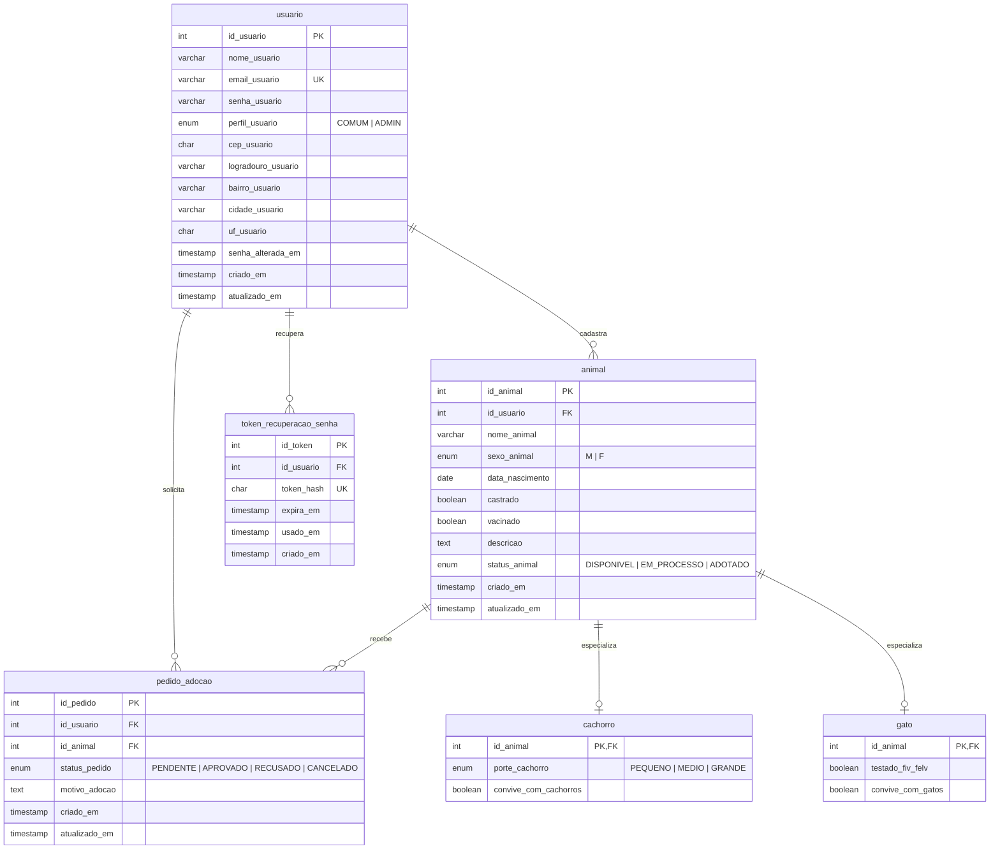

# Sistema de Adoção de Animais

API para gerenciar o processo de adoção de cães e gatos, conectando quem tem animais para doação a pessoas interessadas em adotar.

Projeto desenvolvido para o Desafio Back-end 2026/2 da Comp Júnior.

## Sumário

- [Sobre o sistema](#sobre-o-sistema)
- [Tecnologias](#tecnologias)
- [Entidades](#entidades)
- [DER](#der)
- [Regras de negócio](#regras-de-negócio)
- [Perfis e permissões](#perfis-e-permissões)
- [Autenticação e segurança](#autenticação-e-segurança)
- [Integração externa](#integração-externa)
- [Arquitetura](#arquitetura)
- [Configuração e execução](#configuração-e-execução)
- [Endpoints](#endpoints)
- [Collection](#collection)

## Sobre o sistema

**Categoria:** sistema de gerenciamento do processo de adoção.

Usuários cadastram animais disponíveis para adoção. Outros usuários fazem pedidos de adoção, que o dono do animal aprova ou recusa. O sistema acompanha o status de cada animal e de cada pedido até a adoção ser concluída.

**Inclui:** cadastro e autenticação de usuários, endereço preenchido pelo CEP, cadastro de cães e gatos, pedidos de adoção com aprovação e recusa, recuperação de senha por e-mail.

**Não inclui:** pagamentos, chat entre usuários, agendamento de visitas.

## Tecnologias

- Node.js 22 com JavaScript
- Express 5
- PostgreSQL 17
- Prisma ORM 6
- JWT (`jsonwebtoken`) e `bcryptjs` para autenticação
- Zod para validação dos dados
- Nodemailer e Mailpit para envio de e-mails
- Docker e Docker Compose

## Entidades

| Entidade | Descrição |
|---|---|
| **Usuário** | Pessoa que usa o sistema, com perfil `COMUM` ou `ADMIN` e endereço obtido pelo CEP. |
| **Animal** | Dados comuns a todo animal: nome, sexo, castração, vacinação, descrição, status e dono. |
| **Cachorro** | Dados exclusivos de cães: porte e convivência com outros cães. |
| **Gato** | Dados exclusivos de gatos: teste de FIV/FeLV e convivência com outros gatos. |
| **Pedido de Adoção** | Solicitação de um usuário para adotar um animal, com motivo e status. |

A tabela `token_recuperacao_senha` é de apoio à recuperação de senha e não é uma entidade de negócio.

**Decisões de modelagem**

- **Especialização de animais:** os dados comuns ficam em `animal` e os exclusivos de cada espécie ficam em `cachorro` e `gato`, ligados 1:1 a `animal` pelo próprio `id_animal`. Isso evita colunas duplicadas e campos sem sentido para a outra espécie.
- **Pedido ligado diretamente a um usuário e a um animal (1:N):** cada pedido é de um único adotante para um único animal. Assim o próprio banco impede pedidos ambíguos, e as regras de aprovação ficam simples.
- **Pedidos não são excluídos, e sim cancelados**, para manter o histórico do processo de adoção.

## DER



O schema correspondente está em `prisma/schema.prisma`.

## Regras de negócio

### Usuários
- O e-mail é único (sem diferenciar maiúsculas e minúsculas). E-mail já cadastrado retorna `409`.
- A senha deve ter entre 8 e 72 caracteres, é armazenada apenas como hash (bcrypt) e nunca é retornada nas respostas.
- O cadastro público cria sempre um usuário `COMUM`. Um campo `perfil` enviado no corpo é ignorado.
- O CEP deve ter 8 dígitos, com ou sem hífen (formato inválido retorna `400`). Logradouro, bairro, cidade e UF são preenchidos pelo ViaCEP; CEP inexistente retorna `422`, e ViaCEP indisponível retorna `503` sem salvar dados.
- Um administrador inicial é criado automaticamente ao iniciar a API, com os dados de `ADMIN_EMAIL` e `ADMIN_PASSWORD`, se ainda não existir.

### Animais
- Todo animal é cadastrado como cachorro ou como gato, com os dados específicos da espécie. O animal e seus dados específicos são criados na mesma transação.
- Só o dono do animal ou um administrador pode editá-lo ou excluí-lo.
- Animal com status `ADOTADO` não pode ser excluído, para preservar o histórico.

### Pedidos de adoção
- O usuário não pode pedir para adotar o próprio animal.
- Só é possível pedir animais com status `DISPONIVEL` ou `EM_PROCESSO`, e cada usuário pode ter apenas um pedido ativo por animal.
- O primeiro pedido muda o animal para `EM_PROCESSO`.
- Só o dono do animal (ou um administrador) aprova ou recusa. Ao aprovar, o animal vira `ADOTADO` e os demais pedidos pendentes dele são recusados automaticamente.
- O adotante pode cancelar o próprio pedido enquanto estiver `PENDENTE`.
- `APROVADO`, `RECUSADO` e `CANCELADO` são status finais.
- Não existe exclusão de pedidos: eles são cancelados, para manter o histórico.

## Perfis e permissões

| Recurso | Ação | Usuário Comum | Administrador |
|---|---|---|---|
| Usuário | Ver o próprio perfil | ✅ | ✅ |
| Usuário | Listar todos os usuários | ❌ | ✅ |
| Animal | Cadastrar | ✅ | ✅ |
| Animal | Listar e visualizar | ✅ | ✅ |
| Animal | Editar e excluir | Somente os próprios | ✅ |
| Pedido | Criar | ✅ (exceto para animal próprio) | ✅ |
| Pedido | Aprovar e recusar | Somente pedidos dos próprios animais | ✅ |
| Pedido | Cancelar | Somente os próprios, se pendentes | ✅ |

## Autenticação e segurança

- **Login com JWT:** `POST /auth/login` devolve um token que deve ser enviado nas rotas protegidas no cabeçalho `Authorization: Bearer <token>`. O token expira conforme `JWT_EXPIRES_IN` (padrão: 1 hora).
- **Sem token, ou com token inválido ou expirado:** `401`. **Perfil sem permissão:** `403`.
- **Mensagem única no login:** e-mail inexistente e senha errada retornam a mesma mensagem, para não revelar quais e-mails estão cadastrados.
- **Recuperação de senha:**
  - `POST /auth/forgot-password` sempre responde a mesma mensagem, exista o e-mail ou não.
  - O código enviado por e-mail é aleatório (256 bits), vale por `RESET_TOKEN_EXPIRES_MINUTES` minutos (padrão: 15) e pode ser usado uma única vez.
  - No banco fica guardado apenas o hash SHA-256 do código, nunca o código em si.
  - Pedir um novo código invalida os anteriores.
  - Ao redefinir a senha, todos os tokens JWT emitidos antes da troca deixam de valer.
- **Erros:** respostas de erro nunca expõem detalhes internos. Erros inesperados retornam `500` com mensagem genérica.

## Integração externa

**ViaCEP** (https://viacep.com.br): no cadastro de usuários, a API preenche logradouro, bairro, cidade e UF a partir do CEP. Isso padroniza o endereço e permite filtrar animais por cidade e estado do dono. A API é gratuita e não exige chave.

## Arquitetura

O projeto segue princípios de Clean Architecture. As regras de negócio (casos de uso) não importam Express, Prisma, bcrypt, JWT nem Nodemailer: recebem pelo construtor objetos com os métodos de que precisam. O único lugar que conhece as implementações concretas é o `src/container.js`.

```
src/
├── config/
│   └── env.js            # Leitura das variáveis de ambiente
├── domain/
│   └── errors/           # Erros de aplicação (AppError)
├── application/
│   ├── use-cases/        # Regras de negócio (registrar, logar, recuperar senha...)
│   └── utils/
├── infra/                # Implementações técnicas
│   ├── database/         # Prisma e repositórios
│   ├── security/         # bcrypt, JWT e geração de código de recuperação
│   ├── mail/             # Envio de e-mail (Nodemailer)
│   └── cep/              # Integração com o ViaCEP
├── interfaces/
│   └── http/             # Rotas, controllers, validações e middlewares do Express
├── container.js          # Monta as dependências e liga as camadas
├── app.js                # Montagem da aplicação Express
└── server.js             # Inicialização do servidor
```

Todos os erros passam por um middleware global (`interfaces/http/middlewares/errorHandler.js`), que devolve respostas no formato `{ "error": { "message": "..." } }` e nunca expõe detalhes internos.

## Configuração e execução

### Pré-requisitos
- [Docker Desktop](https://www.docker.com/products/docker-desktop/) (ou Docker Engine com Docker Compose)
- Git

### Passos

1. Clone o repositório:
```bash
   git clone https://github.com/IsadoraRB-dge/Trilha-Backend-CompJr.git
   cd Trilha-Backend-CompJr
```
2. Crie o arquivo `.env` a partir do exemplo. Os valores padrão já funcionam para rodar localmente:
```bash
   cp .env.example .env
```
   No Windows (PowerShell): `Copy-Item .env.example .env`
3. Suba o ambiente:
```bash
   docker-compose up --build
```
   Sobem três serviços: o banco (PostgreSQL), o Mailpit (servidor de e-mail de testes) e a API. As migrations são aplicadas e o administrador inicial é criado automaticamente.
4. Verifique se está tudo funcionando:
```bash
   curl http://localhost:3000/health
```
   Resposta esperada: `{"status":"ok","database":"ok"}`

### Serviços disponíveis

| Serviço | Endereço |
|---|---|
| API | `http://localhost:3000` |
| Caixa de e-mails (Mailpit) | `http://localhost:8025` |

### Administrador inicial

| E-mail | Senha |
|---|---|
| `admin@adocao.local` | `Admin@12345` |

Esses valores vêm de `ADMIN_EMAIL` e `ADMIN_PASSWORD` no `.env` e servem apenas para o ambiente local.

### Testar a recuperação de senha

1. Envie `POST /auth/forgot-password` com o e-mail de um usuário cadastrado.
2. Abra `http://localhost:8025`. O e-mail "Recuperação de senha" aparece na caixa de entrada com o código.
3. Envie `POST /auth/reset-password` com o código e a nova senha.

Nenhum e-mail real é enviado: o Mailpit captura todas as mensagens localmente.

### Variáveis de ambiente

| Variável | Descrição | Padrão |
|---|---|---|
| `POSTGRES_USER` | Usuário do PostgreSQL | `admin` |
| `POSTGRES_PASSWORD` | Senha do PostgreSQL | `adocao_dev` |
| `POSTGRES_DB` | Nome do banco | `adocao` |
| `POSTGRES_PORT` | Porta do PostgreSQL no seu computador | `5433` |
| `API_PORT` | Porta da API no seu computador | `3000` |
| `DATABASE_URL` | URL do banco usada pelo Prisma fora do Docker | ver `.env.example` |
| `JWT_SECRET` | Chave de assinatura dos tokens JWT | valor de desenvolvimento |
| `JWT_EXPIRES_IN` | Validade do token JWT | `1h` |
| `RESET_TOKEN_EXPIRES_MINUTES` | Validade do código de recuperação, em minutos | `15` |
| `SMTP_HOST` / `SMTP_PORT` | Servidor de e-mail usado fora do Docker | `localhost` / `1025` |
| `MAIL_FROM` | Remetente dos e-mails | `Adoção de Animais <nao-responda@adocao.local>` |
| `MAILPIT_UI_PORT` | Porta da caixa de e-mails no seu computador | `8025` |
| `MAILPIT_SMTP_PORT` | Porta SMTP do Mailpit no seu computador | `1025` |
| `ADMIN_NAME` / `ADMIN_EMAIL` / `ADMIN_PASSWORD` | Dados do administrador inicial | ver `.env.example` |

Se alguma das portas já estiver em uso no seu computador, altere a variável correspondente no `.env`.

### Desenvolvimento sem Docker para a API (opcional)

Com o banco e o Mailpit rodando pelo Docker (`docker-compose up -d db mailpit`):
```bash
npm install
npx prisma migrate dev
npm run dev
```

## Endpoints

Formato de erro em todas as rotas:
```json
{ "error": { "message": "Descrição do erro" } }
```
Erros de validação (`400`) trazem também `details`, com o campo e a mensagem de cada problema.

### Resumo

| Método | Caminho | Descrição | Acesso |
|---|---|---|---|
| GET | `/health` | Verifica se a API e o banco estão no ar | Público |
| POST | `/auth/register` | Cadastra um usuário comum | Público |
| POST | `/auth/login` | Autentica e devolve o token JWT | Público |
| GET | `/auth/me` | Dados do usuário autenticado | Autenticado |
| POST | `/auth/forgot-password` | Envia o código de recuperação por e-mail | Público |
| POST | `/auth/reset-password` | Redefine a senha com o código recebido | Público |
| GET | `/usuarios` | Lista todos os usuários | Administrador |

### GET `/health`

**Resposta `200`:**
```json
{ "status": "ok", "database": "ok" }
```
**`503`:** banco indisponível.

### POST `/auth/register`

| Campo | Tipo | Obrigatório | Regras |
|---|---|---|---|
| `nome` | texto | Sim | 2 a 100 caracteres |
| `email` | texto | Sim | E-mail válido, até 150 caracteres |
| `senha` | texto | Sim | 8 a 72 caracteres |
| `cep` | texto | Sim | 8 dígitos, com ou sem hífen |

**Requisição:**
```json
{
  "nome": "Isadora Rocha Brito",
  "email": "Isa@email.com",
  "senha": "senhaSegura123",
  "cep": "01001-000"
}
```
**Resposta `201`:**
```json
{
  "id": 2,
  "nome": "Isadora Rocha Brito",
  "email": "Isa@email.com",
  "perfil": "COMUM",
  "cep": "01001000",
  "logradouro": "Praça da Sé",
  "bairro": "Sé",
  "cidade": "São Paulo",
  "uf": "SP",
  "criadoEm": "2026-10-18T12:00:00.000Z",
  "atualizadoEm": "2026-10-18T12:00:00.000Z"
}
```
**Erros:** `400` dados inválidos · `409` e-mail já cadastrado · `422` CEP não encontrado · `503` ViaCEP indisponível.

### POST `/auth/login`

| Campo | Tipo | Obrigatório |
|---|---|---|
| `email` | texto | Sim |
| `senha` | texto | Sim |

**Requisição:**
```json
{ "email": "Isa@email.com", "senha": "senhaSegura123" }
```
**Resposta `200`:**
```json
{
  "token": "eyJhbGciOiJIUzI1NiIsInR5cCI6IkpXVCJ9...",
  "usuario": { "id": 2, "nome": "Isadora Rocha Brito", "email": "Isa@email.com", "perfil": "COMUM" }
}
```
O objeto `usuario` traz os mesmos campos da resposta do cadastro.

**Erros:** `400` dados inválidos · `401` e-mail ou senha inválidos.

### GET `/auth/me`

**Cabeçalho:** `Authorization: Bearer <token>`

**Resposta `200`:** os dados do usuário autenticado, no mesmo formato da resposta do cadastro.

**Erros:** `401` token ausente, inválido, expirado ou emitido antes de uma troca de senha.

### POST `/auth/forgot-password`

| Campo | Tipo | Obrigatório |
|---|---|---|
| `email` | texto | Sim |

**Requisição:**
```json
{ "email": "Isa@email.com" }
```
**Resposta `200` (sempre a mesma, exista o e-mail ou não):**
```json
{ "message": "Se o e-mail estiver cadastrado, você receberá as instruções para redefinir a senha." }
```
**Erros:** `400` dados inválidos.

### POST `/auth/reset-password`

| Campo | Tipo | Obrigatório | Regras |
|---|---|---|---|
| `token` | texto | Sim | Código recebido por e-mail |
| `novaSenha` | texto | Sim | 8 a 72 caracteres |

**Requisição:**
```json
{ "token": "código-recebido-por-email", "novaSenha": "novaSenha456" }
```
**Resposta `200`:**
```json
{ "message": "Senha redefinida com sucesso. Faça login com a nova senha." }
```
**Erros:** `400` dados inválidos, ou código inválido, expirado ou já utilizado.

### GET `/usuarios`

**Cabeçalho:** `Authorization: Bearer <token de administrador>`

**Resposta `200`:** lista de usuários, cada um no mesmo formato da resposta do cadastro.

**Erros:** `401` não autenticado · `403` usuário sem perfil de administrador.

## Collection

A collection do Postman será adicionada em `docs/collection.json` conforme os endpoints forem implementados.